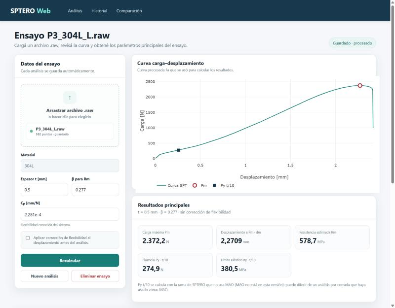
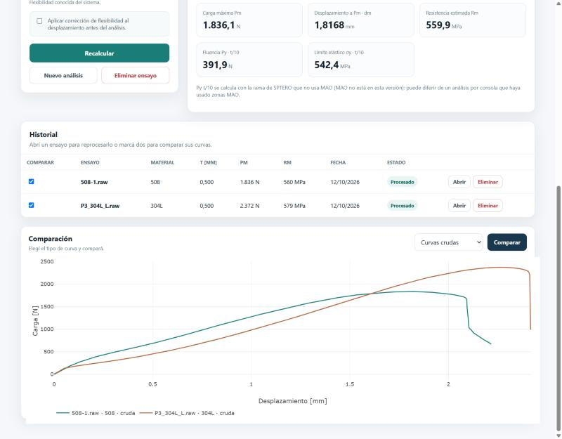

# TP final — SPTERO Web

Aplicación web para analizar ensayos Small Punch Test (SPT). Se sube el `.raw` que
exporta la máquina Instron, se procesa con el mismo motor científico que el SPTERO
original y se obtienen Pm, dm, Rm y la fluencia por t/10. Cada ensayo queda
guardado con su archivo, sus parámetros y su resultado, y se puede volver a abrir,
reprocesar, corregirle el espesor o comparar su curva con la de otro.

Backend en FastAPI con SQLite, interfaz en HTML, CSS y JavaScript sin paso de
build, con Plotly.js para los gráficos. El diseño está en la
[spec](docs/superpowers/specs/2026-10-12-sptero-web-design.md), las tareas en el
[plan](docs/superpowers/plans/2026-10-12-sptero-web.md) y el registro de prompts en
[prompts.md](prompts.md).



## Cómo se ejecuta

Hace falta Python 3.12 (es la versión con la que se probó) y conexión a internet,
porque Plotly.js se carga desde un CDN. Sin internet la API funciona, pero la
página no puede dibujar los gráficos.

Todos los comandos se corren desde la carpeta `tp-final/`.

**Windows (PowerShell):**

```powershell
cd tp-final
py -3.12 -m venv .venv
.venv\Scripts\python -m pip install -r requirements.txt
.venv\Scripts\python -m uvicorn app.main:app
```

**Linux o macOS:**

```bash
cd tp-final
python3.12 -m venv .venv
.venv/bin/python -m pip install -r requirements.txt
.venv/bin/python -m uvicorn app.main:app
```

Después se abre `http://localhost:8000`. No hace falta activar el entorno virtual:
llamar al `python` de `.venv` alcanza. La documentación interactiva de FastAPI está
en `http://localhost:8000/docs`, pero el contrato es [`openapi.yaml`](openapi.yaml)
(ver "Limitaciones conocidas").

La base se crea sola la primera vez, en `data/sptero.db`. Para empezar de cero
alcanza con borrar ese archivo con el servidor apagado. Si el puerto 8000 está
ocupado, se levanta en otro con `--port 8765` y se abre esa dirección.

**Variables de entorno (todas opcionales):**

| Variable | Para qué |
|---|---|
| `SPTERO_DB` | Ruta de la base. Por defecto, `data/sptero.db`. |
| `SPTERO_ORIGINAL` | Ruta local a `Programa SPTERO.py`, para los tests de caracterización. |
| `SPTERO_RAW_SAMPLE` | Ruta local a un `.raw` real (el de referencia es `P3_304L_L.raw`). |

En PowerShell se definen para la sesión con `$env:SPTERO_DB = "data\prueba.db"`;
en bash, anteponiéndolas al comando (`SPTERO_DB=data/prueba.db .venv/bin/python …`).

**Tests:**

```powershell
.venv\Scripts\python -m pytest
```

Usan bases temporales y archivos `.raw` sintéticos, así que no tocan
`data/sptero.db`. Sin `SPTERO_ORIGINAL` y `SPTERO_RAW_SAMPLE` se saltean los 14
tests que comparan con el script original. Para correrlos:

```powershell
$env:SPTERO_ORIGINAL = "C:\ruta\a\Programa SPTERO.py"
$env:SPTERO_RAW_SAMPLE = "C:\ruta\a\P3_304L_L.raw"
.venv\Scripts\python -m pytest -v
```

El script original y los `.raw` experimentales no están en el repositorio (ver
decisiones).

## Cómo se usa

1. **Nuevo análisis.** Arrastrar un `.raw` a la zona de carga (o hacer clic para
   elegirlo), completar material y espesor, y tocar **Analizar ensayo**. Los
   números aceptan coma o punto decimal. Si se marca la corrección de flexibilidad,
   se usa el C_P del campo (por defecto 2,281e-4 mm/N); β por defecto es 0,277.
2. El ensayo se guarda solo: el indicador de arriba pasa por "Guardando…" y queda
   en "Guardado · procesado". Aparecen la curva con los marcadores de Pm y Py t/10
   y las cinco tarjetas de resultados.
3. **Reprocesar.** Con un ensayo abierto, cambiar β, C_P, la corrección o el
   espesor y tocar **Recalcular**. No se crean versiones: el resultado anterior se
   reemplaza.
4. **Historial.** Lista los ensayos, del más reciente al más viejo. **Abrir** carga
   uno con sus parámetros; **Eliminar** pide confirmación y borra el ensayo, su
   archivo y su resultado.
5. **Comparar.** Marcar dos ensayos en el historial, elegir curvas crudas o
   procesadas y tocar **Comparar**. Las procesadas solo se habilitan si los dos
   ensayos están procesados.
6. El gráfico es de Plotly: zoom con el mouse, doble clic para restablecer los ejes
   y valores al pasar el cursor.

| Historial | Comparación |
|---|---|
|  |  |

## Qué me propuse construir

SPTERO es un script de Python que uso para analizar ensayos SPT. Funciona por
consola: pide los parámetros con `input()`, abre diálogos de tkinter, muestra los
gráficos con matplotlib y deja los resultados en un PDF suelto. No hay historial
ni forma de volver a un análisis.

El objetivo fue tener el mismo análisis científico en un flujo web completo y
persistente: cargar el `.raw`, procesarlo, ver la curva, calcular Pm, dm, Rm y la
fluencia por t/10, guardar, consultar el historial, reprocesar y comparar. El
criterio de éxito era que, con el ensayo de referencia `P3_304L_L.raw`, la web diera
los mismos valores que el SPTERO original (tolerancia relativa 1e-9) y que el
recorrido de punta a punta funcionara en el navegador.

El punto de partida fue el contrato que diseñé en el [TP2](../TP2/README.md), que
acá evoluciona a la versión 1.1.

**Quedó afuera del MVP:** probetas entalladas, cálculo automático de C_P, MAO y Fe
bilineal, ductilidad, reportes PDF, autenticación, procesamiento en lote y
dashboards. La comparación de dos ensayos estaba en el roadmap y la adelanté al MVP,
acotada a dos curvas y sin métricas comparativas.

## Arquitectura

Un solo proceso sirve la API y la interfaz.

```
Navegador (HTML + CSS + JS vanilla + Plotly.js)
        │  HTTP/JSON, contrato openapi.yaml v1.1
        ▼
app/main.py         rutas, validación de entrada, errores {code, message}
        │
        ▼
app/service.py      casos de uso: lee el archivo, llama al core, guarda
        │
        ├──► sptero_core/        lógica científica pura (numpy)
        └──► app/repository.py   SQL explícito con sqlite3
                    │
                    ▼
              data/sptero.db
```

**Regla de dependencias:** core ← service ← rutas. `sptero_core` no importa nada de
`app/` ni de FastAPI, no imprime y no lee archivos: recibe bytes y devuelve datos.
Por eso se puede testear solo y comparar directamente con el script original. Las
rutas no hacen cálculos ni SQL; delegan en el servicio.

```
tp-final/
├── sptero_core/        motor científico copiado de SPTERO, sin cambiar fórmulas
│   ├── raw.py          lectura del .raw (desde bytes)
│   ├── preproceso.py   corrección de flexibilidad y cero por precarga
│   ├── calculos.py     Pm/dm, Rm, regresión, Py t/10, σy
│   └── analisis.py     analizar(): el pipeline que reemplaza al main() de consola
├── app/
│   ├── main.py         rutas FastAPI, handlers de error, sirve static/
│   ├── schemas.py      modelos Pydantic que reflejan openapi.yaml
│   ├── service.py      casos de uso y traducción de errores a HTTP
│   └── repository.py   tablas, transacciones y consultas SQLite
├── static/             index.html, styles.css, app.js
├── tests/              pytest: caracterización, core, repositorio, servicio, API, contrato, concurrencia
├── openapi.yaml        contrato v1.1 (evoluciona desde ../TP2/openapi.yaml, que no se toca)
├── docs/
│   ├── superpowers/    spec y plan
│   ├── capturas/       capturas de la verificación en el navegador
│   └── pendientes.md   hallazgos de las revisiones que quedaron sin resolver
├── .claude/            configuración del agente (ver "Cómo gestioné el contexto")
├── prompts.md
└── data/               base local (no se versiona)
```

### Endpoints

| Método | Ruta | Para qué | Respuestas |
|---|---|---|---|
| `POST` | `/tests` | Subir un ensayo (multipart: `file`, `material`, `thickness_mm`) | `201` · `400` |
| `GET` | `/tests` | Historial, del más reciente al más viejo | `200` |
| `GET` | `/tests/{testId}` | Detalle, con `result` o `null` | `200` · `400` · `404` |
| `PATCH` | `/tests/{testId}` | Corregir el espesor y recalcular | `200` · `400` · `404` · `422` |
| `DELETE` | `/tests/{testId}` | Borrar ensayo, archivo y resultado | `204` · `400` · `404` |
| `GET` | `/tests/{testId}/file` | Descargar el `.raw` original | `200` · `400` · `404` |
| `GET` | `/tests/{testId}/curve?source=raw\|processed` | Curva cruda o procesada | `200` · `400` · `404` |
| `PUT` | `/tests/{testId}/result` | Procesar o reprocesar (idempotente) | `200` · `400` · `404` · `422` |
| `GET` | `/tests/{testId}/result` | Consultar el resultado | `200` · `400` · `404` |

Los errores siempre tienen la forma `{"code": ..., "message": ...}`, con el mensaje
en español: `400 INVALID_FILE` o `INVALID_PARAMETERS`, `404 TEST_NOT_FOUND` o
`RESULT_NOT_FOUND`, `422 PROCESSING_FAILED`. Los `400` de los endpoints con
`{testId}` son por un id que no es un entero entre 1 y 2^63−1.

### Datos

Dos tablas. `tests` guarda el ensayo: `id`, `filename`, `material`, `thickness_mm`
(con `CHECK > 0`), `uploaded_at`, `point_count` y el `.raw` original como BLOB en
`raw_file`. `results` tiene a lo sumo una fila por ensayo (`test_id` es clave
primaria y foreign key con `ON DELETE CASCADE`): los parámetros usados
(`apply_compliance_correction`, `compliance_mm_per_n`, `beta`), los resultados
(`pm_n`, `dm_mm`, `rm_mpa`, `py_t10_n`, `py_t10_displacement_mm`,
`sigma_y_t10_mpa`) y `processed_at`. Las tres columnas de t/10 admiten `NULL` si
no se encuentra el cruce.

### Contrato entre la interfaz y el servidor

Cada acción de la página hace estas llamadas, todas desde la función `pedir` de
`static/app.js`:

| Acción en la interfaz | Llamadas |
|---|---|
| Cargar la página | `GET /tests` |
| **Analizar ensayo** (nuevo) | `POST /tests` → `PUT /tests/{id}/result` → `GET /tests/{id}` → `GET /tests/{id}/curve?source=…` → `GET /tests` |
| **Recalcular** | `PATCH /tests/{id}` si cambió el espesor, después `PUT /tests/{id}/result` si cambiaron los parámetros, y la misma reapertura |
| **Abrir** en el historial | `GET /tests/{id}` → `GET /tests/{id}/curve?source=…` |
| **Eliminar** | `confirm()` → `DELETE /tests/{id}` → `GET /tests` |
| **Comparar** | dos `GET /tests/{id}/curve?source=raw\|processed`, en paralelo |

La curva que se dibuja en el análisis es la procesada si el ensayo tiene resultado,
y la cruda si no. Comparar no modifica ningún ensayo.

Un ejemplo del contrato:

```
PUT /tests/1/result
{ "apply_compliance_correction": true }

200
{ "pm_n": 2372.199, "dm_mm": 1.7319210566981, "rm_mpa": 758.8095548104908,
  "py_t10_n": 281.8452008506936, "py_t10_displacement_mm": 0.20667531164703912,
  "sigma_y_t10_mpa": 390.0737579773599,
  "parameters": { "apply_compliance_correction": true, "compliance_mm_per_n": 0.0002281, "beta": 0.277 },
  "processed_at": "2026-10-12T22:42:35+00:00" }
```

## Fragmentos clave del código

**El pipeline (D1)**, en `sptero_core/analisis.py`. Es lo único nuevo del core: el
resto son copias del original. El cero por precarga se aplica solo dentro de la
rama con corrección, como en el script, y t/10 usa la rama sin MAO.

```python
def preprocesar(curva: CurvaRaw, parametros: ParametrosProcesamiento):
    x, y = curva.x, curva.y
    if parametros.aplicar_correccion:
        x = corregir_desplazamiento_por_flexibilidad_A1(x, y, parametros.cp_mm_por_n)
        # Re-ordenar por x por si la corrección genera pequeños desórdenes
        idx = np.argsort(x)
        x = x[idx]
        y = y[idx]
        x, y, _i0, _x0, _y0 = cero_automatico_por_precarga(x, y, F0_N=F0_PRECARGA_N, shift_force=False)
    return x, y


def analizar(contenido: bytes, espesor_mm: float, parametros: ParametrosProcesamiento) -> ResultadoAnalisis:
    x, y = preprocesar(leer_raw(contenido), parametros)

    pm, dm, _ = max_load_and_dm(x, y)
    rm = rm_from_beta(pm, dm, espesor_mm, parametros.beta)
    if rm is None:
        raise ValueError(f"No se puede calcular Rm: dm = {dm:.4f} mm, tiene que ser mayor que cero.")

    t10 = estimar_py_t10(x, y, t_mm=espesor_mm, mask_zonaI_used=None)
    ...
```

**La atomicidad del `PATCH` (D2)**, en `app/service.py` y `app/repository.py`.
Lectura, cálculo y escritura van dentro de una sola transacción `BEGIN IMMEDIATE`.
Si `_calcular` falla, la excepción sale del `with` antes de escribir y el
`ROLLBACK` deja el espesor y el resultado como estaban.

```python
def corregir_espesor(con, test_id: int, thickness_mm: float) -> dict:
    with repository.transaccion(con):
        ensayo = _ensayo_o_404(con, test_id)
        if ensayo["thickness_mm"] == thickness_mm:
            return ensayo
        nuevo = None
        if ensayo["result"] is not None:
            nuevo = _calcular(_contenido(con, test_id), thickness_mm, _parametros_de(ensayo["result"]))
        repository.actualizar_espesor(con, test_id, thickness_mm, nuevo)
        return repository.obtener_ensayo(con, test_id)
```

```python
@contextmanager
def transaccion(con):
    if con.in_transaction:
        yield
        return
    con.execute("BEGIN IMMEDIATE")
    try:
        yield
        con.execute("COMMIT")
    except BaseException:
        if con.in_transaction:
            con.execute("ROLLBACK")
        raise
```

**La validación responde 400, no 422**, en `app/main.py`. FastAPI contesta 422 con
su propio formato ante una entrada inválida; el contrato pide `400
INVALID_PARAMETERS` con el formato `Error` y el mensaje en español.

```python
@app.exception_handler(RequestValidationError)
def error_validacion(_request, error: RequestValidationError):
    detalle = "; ".join(_mensaje_validacion(e) for e in error.errors())
    return JSONResponse(status_code=400, content={"code": "INVALID_PARAMETERS", "message": f"Parámetros inválidos: {detalle}"})
```

## Decisiones que tomé yo

Decisiones cerradas al revisar la spec (12/10/2026). El detalle técnico de cada
una está en la [spec](docs/superpowers/specs/2026-10-12-sptero-web-design.md). Las
justifico con cuatro criterios: simplicidad, reutilización del SPTERO original,
trazabilidad científica y un alcance razonable para el MVP.

**Sumar la fluencia por t/10 al MVP con un contrato v1.1.** La presentación la
incluía y el contrato del TP2 no. El `Result` suma `py_t10_n` y `sigma_y_t10_mpa`.
Por qué: el cálculo ya existe en SPTERO (`estimar_py_t10`) y se reutiliza tal cual,
así que suma un resultado científico relevante con poco costo y sin salirse del
alcance del MVP.

**Reutilizar el motor científico copiándolo a un módulo propio, sin cambiar
fórmulas.** Se quita solo la interfaz de consola, y cada función se compara con la
original en tests. Por qué: reutiliza el SPTERO original sin arrastrar tkinter,
matplotlib ni los `print` al servidor, y la comparación función por función da
trazabilidad científica: cada número de la web se puede rastrear hasta el script.

**SQLite con `sqlite3` de la biblioteca estándar, y el `.raw` original guardado
como BLOB** junto con parámetros y resultados. Por qué: es lo más simple que
alcanza para dos tablas (sin ORM ni dependencias extra), y guardar el archivo
original con los parámetros usados permite reproducir cualquier resultado desde su
fuente.

**D1 — Seguir la secuencia de preprocesamiento del SPTERO original.** El cero por
precarga se aplica solo junto con la corrección de flexibilidad, como en el
script. Esto revierte la decisión 4 del TP2, que lo aplicaba siempre; el cambio
vive en el contrato v1.1 de esta carpeta. Por qué: trazabilidad científica; si la
secuencia difiere, los resultados dejan de ser comparables con los de SPTERO.

**D2 — Poder corregir el espesor de un ensayo guardado y recalcular, sin
versiones.** Se agrega `PATCH /tests/{id}` en el contrato v1.1; el TP2 no se toca.
Si el recálculo falla, no cambia ni el espesor ni el resultado anterior. Por qué:
un espesor mal cargado no debería obligar a borrar y volver a subir el ensayo, y no
tener versiones mantiene el modelo simple (un ensayo, un resultado), dentro del
alcance del MVP.

**D3 — Comparar dos curvas del mismo tipo, crudas o procesadas, a elección.** Por
qué: superponer curvas de distinto tipo mezclaría coordenadas distintas (con y sin
corrección de flexibilidad); comparar del mismo tipo mantiene la comparación
científicamente válida. Limitarla a dos curvas la deja dentro del MVP.

**D4 — Guardado automático con estado visible, sin botón Guardar, y eliminación
con confirmación.** Por qué: simplicidad; el contrato ya persiste el ensayo al
subirlo, así que un botón Guardar sería redundante. Como todo queda guardado,
eliminar es la única acción destructiva y por eso pide confirmación.

**D5 — La configuración del agente vive en `tp-final/.claude/` y las sesiones
arrancan en `tp-final/`.** Se verificó que, si no, Claude Code no carga los
permisos ni el subagente. Por qué: es lo que pide la consigna y lo más simple de
mantener, con todo el TP final en una sola carpeta.

**No publicar el `.raw` experimental ni el script original.** Los tests que los
necesitan leen rutas locales y se saltean si no están. Por qué: por ahora prefiero
no publicar esos archivos. La trazabilidad científica se conserva igual: los
valores de referencia quedan fijados en la spec y la comparación con el original
se puede repetir localmente.

### Decisiones de la etapa 2 (motor científico)

**Sin corrección de flexibilidad por defecto, como en el TP2.**
`ParametrosProcesamiento.aplicar_correccion` vale `False`, igual que
`apply_compliance_correction` en el contrato. Esto es distinto del SPTERO
original: en la consola, Enter aplica la corrección. Con el mismo `.raw`, la web
con los valores por defecto da el caso sin corrección (en `P3_304L_L.raw`,
dm = 2,2709 mm) y Enter en la consola da el caso con corrección (dm = 1,7319 mm).
Por qué: mantener el default del contrato del TP2, del que evoluciona el v1.1. La
diferencia queda escrita en el docstring de `sptero_core/analisis.py`.

**Un `.raw` dañado es un error de archivo, no una caída.** El original deja
escapar `csv.Error` cuando el archivo tiene, por ejemplo, una comilla sin cerrar.
`leer_raw` lo convierte en `ValueError`, que la API va a traducir a 400
`INVALID_FILE`. Por qué: es un cambio de entrada/salida, no toca las reglas de
lectura, y así el core cumple su regla de errores y la web nunca responde 500 por
un archivo malo. Lo detectó la revisión final de la rama y tiene su test.

**Comparar también `encontrar_inicio_tabla` con el original.** El plan comparaba
8 funciones por AST y dejaba afuera esta, que también es copia textual. La sumé
(la caracterización tiene 14 tests en vez de 13) porque la regla del core pide
comparar cada función copiada.

### Decisiones de la etapa 3 (API)

Esta etapa la ejecutó el agente con autonomía delegada: le pedí que no me
consultara entre tareas y que frenara solo ante decisiones de alcance o de
arquitectura. Las decisiones de abajo las tomó el agente al implementar o al
revisar; las revisé antes del PR y las aprobé. La de concurrencia la tomé yo.

**Rechazar números no finitos en todas las entradas.** Pydantic acepta `inf`, y
el parser JSON de Starlette acepta `Infinity` y `NaN`. Un espesor infinito pasaba
el `gt=0`, se guardaba y rompía la respuesta con un 500. Todas las entradas
numéricas usan `allow_inf_nan=False`. Con esto se resolvió el pendiente 1 de la
etapa 2.

**Un `testId` fuera de int64 es un parámetro inválido.** El contrato ya declara
`format: int64`, así que un id más grande responde 400 `INVALID_PARAMETERS` y no
404. Antes daba 500 porque sqlite3 no puede ligar ese número.

**Los mensajes de validación se traducen.** El plan armaba el `message` con el
texto de Pydantic, que está en inglés, y eso contradecía la restricción de
mensajes en español. Se traduce cada tipo de error, con un mensaje genérico de
respaldo.

**Un recálculo que no da un número finito es `PROCESSING_FAILED`.** Con un
espesor absurdamente chico (1e-170) el core lanzaba `ZeroDivisionError` y la API
respondía 500. Con β = 1e308 se guardaba un Rm infinito. El servicio captura
también `ArithmeticError` y rechaza resultados no finitos con 422, sin tocar el
core.

**Cuerpos JSON con tipos estrictos.** `{"thickness_mm": true}` se guardaba como
1 mm. Los cuerpos de `PATCH` y `PUT` validan tipos en modo estricto, como dice el
contrato (`type: number`/`boolean`). Los números enteros siguen valiendo. El
formulario de `POST` sigue aceptando texto, porque los campos multipart llegan
como texto.

**El test de contrato compara más que las rutas.** Ahora la app declara sus
respuestas de error con un modelo `Error`, y `test_contrato.py` compara también
los campos requeridos y los códigos de estado de cada operación contra
`openapi.yaml`. Antes un código o un `required` faltante pasaba sin aviso.

**Nombres de archivo no ASCII en la descarga.** Starlette codifica las cabeceras
en latin-1, así que "ensayo_€.raw" daba 500. Se usa `filename*=utf-8''…`, igual
que `FileResponse`.

**`PATCH` y `PUT` se serializan con `BEGIN IMMEDIATE` (decisión mía).** La
revisión final encontró que un `PUT` que llegaba mientras corría un `PATCH` sobre
el mismo ensayo podía quedar pisado sin aviso, y al revés: un `PUT` en curso podía
guardar un Rm calculado con el espesor viejo. Las dos operaciones leían, calculaban
y recién después escribían, con la lectura fuera de la transacción. Elegí
resolverlo en la base y no en la interfaz:
- Las conexiones se abren en modo autocommit y las transacciones son explícitas,
  con `repository.transaccion(con)`. Ese context manager hace `BEGIN IMMEDIATE`,
  confirma al final y deshace ante cualquier error, también si falla el propio
  `COMMIT`. Se puede anidar: dentro de una transacción, las escrituras del
  repositorio no confirman por su cuenta.
- `procesar` y `corregir_espesor` hacen lectura, cálculo y escritura dentro de
  una sola transacción. El segundo pedido espera el lock de escritura y, cuando
  entra, lee lo que dejó el primero.
- Si el cálculo falla, el `ROLLBACK` deja el espesor y el resultado como estaban.

Los tests de `tests/test_concurrencia.py` reproducen los dos casos con dos
conexiones y dos hilos, frenando el primer cálculo. Con el código anterior fallan:
el estado final quedaba con β = 0,277 en vez de 0,4, o con Rm = 576 MPa
(calculado con t = 0,5) en vez de 1152 MPa. La espera del lock es de 5 s. Si se
vence, el pedido termina en 500 sin guardar nada; para una app local con un solo
usuario es aceptable, porque el cálculo dura milisegundos.

**Contrato validado.** `openapi.yaml` se validó con `openapi-spec-validator`
0.9.0 como OpenAPI 3.1.0, sin errores. La herramienta se instaló en un directorio
temporal, fuera de las dependencias del proyecto. Como contraprueba, un `$ref`
roto puesto a propósito sí lo detecta.

Los hallazgos de las revisiones que quedaron para más adelante están en
[docs/pendientes.md](docs/pendientes.md).

### Decisiones de la etapa 4 (interfaz)

Las tomó el agente durante la ejecución y quedaron registradas en
[docs/pendientes.md](docs/pendientes.md) para que las revisara. Aprobé la etapa sin
cambios antes del PR (prompt 14).

**Los botones del formulario se deshabilitan mientras hay un pedido en curso.** Un
doble clic en **Analizar ensayo** mandaba dos `POST` y dejaba el mismo ensayo
duplicado en el historial, y la spec pide no crear versiones.

**Los nombres de archivo y el material se escapan antes de pasarlos a Plotly.**
Plotly interpreta etiquetas HTML en la leyenda y el hover, y la regla del plan es que
los datos del usuario nunca se interpreten como HTML (en el resto de la página van
con `textContent`). Se probó con un archivo llamado `<b>dos</b>.raw`.

**El gráfico de comparación se limpia cuando deja de corresponder.** Si se desmarca
o se borra uno de los ensayos comparados, o si cambia el resultado de alguno con
curvas procesadas, el gráfico se vacía en lugar de mostrar datos que ya no existen.

**El mockup se tomó del plan.** `index_sptero_mockup.html` no está en el
repositorio, así que se usó el HTML/CSS del plan, que ya estaba derivado de él.

**Capturas en JPG**, no PNG como decía el plan, porque es lo que guarda la
herramienta de captura del navegador integrado.

### Decisiones de la etapa 5 (entrega)

Las tomó el agente en esta etapa; quedan para mi revisión antes del PR.

**La instalación limpia se probó en un clon temporal con ruta corta.** El clon de la
rama dentro del directorio temporal de la sesión falló por el límite de 260
caracteres de Windows ("Filename too long"), así que se usó `%TEMP%\spl`.

**No se cambió código.** La verificación no encontró nada que impidiera instalar,
ejecutar o usar la aplicación, así que esta etapa solo toca documentación. Los
hallazgos nuevos quedaron en `docs/pendientes.md`.

**Las rutas locales que aparecen en el plan no se borran.** El plan tiene dos
comandos con la ruta de mi carpeta de ensayos. No exponen datos (los `.raw` no están
en el repositorio) y ya están en el historial público, así que borrarlas de la
última versión no cambiaría nada.

## Cómo gestioné el contexto

El proyecto se hizo en cinco sesiones de Claude Code (una por etapa), así que nada
importante podía depender de la memoria de una conversación. Lo que sostuvo el
contexto entre sesiones:

- **Spec y plan en disco.** La spec salió de `brainstorming` y el plan de
  `writing-plans` (Superpowers), y los dos están en `docs/superpowers/`. Cada sesión
  arrancaba leyéndolos; el plan tiene 13 tareas, cada una con el test que tiene que
  fallar primero y el resultado esperado. La primera sesión se hizo en plan mode,
  sin tocar archivos hasta aprobar el plan.
- **`CLAUDE.md` jerárquico.** El de la raíz tiene las reglas de todo el repositorio
  (proponer antes de tocar, las decisiones son mías, no hacer push sin pedido) y el
  de `tp-final/` el mapa de carpetas, los comandos y las decisiones D1–D5.
- **Rules por carpeta.** `.claude/rules/core.md` (no tocar fórmulas, cada función
  copiada con su test contra el original) y `.claude/rules/api.md` (el contrato manda,
  errores en formato `Error`, `PATCH` atómico).
- **Permisos en `.claude/settings.json`.** `allow` para pytest, uvicorn y git de
  lectura; `ask` para commit, push, merge e instalar paquetes; `deny` para editar
  `TP1/` y `TP2/` y para `rm -rf`. La regla sobre `TP1/` se comprobó en la etapa 2 y
  la de `rm -rf` frenó un comando del propio agente en la etapa 5.
- **Sesiones desde `tp-final/` (D5).** Se verificó que, si la sesión arranca en la
  raíz, Claude Code no carga `settings.json` ni el subagente de `tp-final/.claude/`.
- **Subagentes para aislar contexto.** En la primera sesión, dos de exploración en
  paralelo (este repositorio y el de la materia) y uno de consulta sobre la
  documentación de Claude Code. Desde la etapa 2, `subagent-driven-development`: un
  subagente implementaba cada tarea y otro la revisaba. El subagente propio
  `verificador-cientifico` (solo lectura) compara el core con el script original, así
  que la sesión principal nunca cargó las 1.500 líneas del script. En la etapa 5, un
  subagente leyó los transcripts de las sesiones anteriores para recuperar los
  prompts textuales.
- **Skill propia `registrar-prompt`.** Agrega una entrada a `prompts.md` con el
  formato del repositorio y deja "Qué buscaba" para mí. Se invoca solo a mano
  (`disable-model-invocation`), porque qué prompt es relevante lo decido yo.
- **Un ledger de progreso** (`.superpowers/`, fuera del repositorio) donde el agente
  anotaba cada tarea terminada, cada decisión que tomaba y cada hallazgo diferido.
  Los hallazgos que importaban pasaron a `docs/pendientes.md`, que sí se versiona.
- **MCP: el navegador integrado de la app de escritorio.** No hay Node instalado, así
  que en vez de Playwright la interfaz se probó con el navegador integrado, que
  expone sus herramientas por MCP.

**TDD.** Cada tarea de Python arrancó con el test en rojo: los reportes de los
subagentes registran la falla antes del código (por ejemplo, `ModuleNotFoundError:
No module named 'app'` en el repositorio, o los tests de concurrencia fallando con
el código anterior). El JavaScript no tiene tests automáticos porque no hay Node; se
verificó en el navegador, con el recorrido completo en cada tarea.

**GitHub Flow.** Una rama por etapa desde `main` actualizado
(`feature/tp-final-spec`, `-core`, `-api`, `-ui`, `-entrega`), un commit por tarea
verificada y un PR por etapa que revisé y fusioné yo (#2 a #5 para el TP final).
Los commits llevan el `Co-Authored-By` del modelo que los escribió.

**Etapa 2.**
- Comprobé la regla `deny` sobre `TP1/`: la sesión, abierta en `tp-final/`,
  intentó editar `../TP1/README.md` y la herramienta lo rechazó ("File is in a
  directory that is denied by your permission settings"). Era el chequeo que la
  spec (§10) dejaba pendiente.
- Las cuatro tareas se hicieron con subagentes: uno implementaba cada tarea y otro
  la revisaba contra la spec y el original. Al final, una revisión de toda la rama
  y el subagente `verificador-cientifico`. Así, la sesión principal no tuvo que
  cargar las 1.500 líneas del script.
- Cada commit lleva el `Co-Authored-By` del modelo que lo escribió (Haiku en las
  tareas 1 a 3, Sonnet en la 4).

**Etapa 3.**
- Igual que en la etapa 2: un subagente implementaba cada tarea y otro la revisaba
  contra la spec, el contrato y la atomicidad del `PATCH`. Al final hubo una
  revisión de toda la rama, una ronda de correcciones con su re-revisión y el
  `verificador-cientifico`.
- El verificador comparó la API contra el script original con `P3_304L_L.raw`:
  sin corrección, con corrección y con `PATCH` a 0,25 mm. La diferencia relativa
  fue 0 en las seis magnitudes.
- Además se levantó uvicorn sobre una base temporal y se probó todo con `curl`:
  alta, procesamiento, idempotencia, `PATCH`, curva, descarga byte a byte y
  borrado.

**Etapa 4.**
- Los subagentes implementaron las tareas de la interfaz, pero la verificación en el
  navegador la hizo la sesión principal, que es la que tiene el navegador integrado.
- El navegador integrado no puede elegir archivos locales. Para que el `POST` lo
  hiciera la interfaz con el `.raw` real, se subió una copia por la API, el navegador
  leyó sus bytes, se borró la copia y se soltó el archivo sobre la zona de carga.

**Etapa 5.**
- Ejecución inline (`executing-plans`), porque era una sola tarea de documentación y
  verificación. El trabajo pesado se delegó en dos subagentes en segundo plano: el
  `verificador-cientifico` y el que recuperó los prompts de las sesiones anteriores.
- La consigna se releyó del repositorio de la materia
  (`semanas/04/source_material/14-trabajo-final.md`,
  `semanas/05/source_material/15-bajada-al-tp-final.md` y el ejemplo
  `apellido-iisaia/tp-final`) para revisar el informe contra lo que se pide.

## Qué salió mal y cómo lo corregí

**Etapa 2.**
- **Un comando colgado.** El agente principal dejó un `cat` sin entrada al armar
  un script de comparación, y el comando se colgó hasta que lo cortó. No tuvo
  efectos.
- **El plan no cubría el archivo dañado.** La revisión final encontró que un
  `.raw` con una comilla sin cerrar hacía fallar a `leer_raw` con `csv.Error`, que
  no es `ValueError`. Lo corregí con un test que primero falló.
- **El docstring contradecía el código.** Decía que se usaban los valores por
  defecto del original, y `aplicar_correccion` no lo es. Lo detectó el
  verificador científico y lo corregí.

**Etapa 3.**
- **El plan contradecía su propia restricción.** El handler de validación que
  traía el plan armaba los mensajes con el texto de Pydantic, en inglés. Lo
  notamos al probar con el servidor real ("Input should be greater than 0") y la
  revisión final lo confirmó. Se tradujo por tipo de error, con tests.
- **El test de contrato era débil.** Solo comparaba rutas y nombres de campos. La
  revisión de la Task 8 lo marcó y se reforzó (ver decisiones).
- **Entradas que terminaban en 500.** Ids fuera de int64, números infinitos,
  espesores absurdamente chicos y nombres de archivo con "€". Ninguno estaba en el
  plan; los encontraron las revisiones y cada uno tiene su test.
- **Una decisión que se tomó mal y se corrigió.** Al empezar, el agente dio por
  aceptable la lectura fuera de la transacción en el `PATCH`, pensando que lo
  único que podía pasar era un 500 si se borraba el ensayo en el medio. La
  revisión final mostró que también se puede perder una actualización sin aviso.
  La resolví con `BEGIN IMMEDIATE` antes del PR (ver decisiones).
- **Un test de concurrencia que tiró abajo el proceso.** La primera versión de
  `test_concurrencia.py` cerraba las conexiones con los hilos todavía vivos, y
  Python terminó con "access violation". Ahora los hilos se esperan en un
  `finally` antes de cualquier assert, y todas las esperas tienen timeout.
- **La validación del contrato no salió a la primera.** Instalar el validador en
  un entorno temporal falló por el límite de longitud de rutas de Windows, y hubo
  que usar un directorio con una ruta más corta.
- **Un permiso que bloqueó la copia del contrato.** El `cp` desde `../TP2` fue
  denegado. El subagente copió el contrato leyéndolo y escribiéndolo de nuevo, y
  después se comprobó con `diff` que solo cambiaban las ediciones del plan.

**Etapa 4.**
- **Clics que parecían bugs y eran errores del agente.** Un clic por coordenadas
  cayó fuera de **Nuevo análisis** porque la página se había desplazado, y después
  de navegar a `#comparacion` (que solo cambia el hash, no recarga) el agente usó una
  referencia a un botón de antes de recargar, así que **Comparar** pareció no andar.
  En los dos casos lo diagnosticó antes de tocar código y repitió la prueba bien.
- **La revisión final encontró datos viejos en pantalla.** Al borrar un ensayo que
  estaba en la comparación, el gráfico seguía mostrando su curva; al abrir un ensayo
  quedaba el aviso de error del anterior, y uno sin procesar heredaba β, C_P y la
  corrección del que estaba abierto. Se corrigió en `aa2c6e3` y se volvió a probar en
  el navegador.
- **Lo que la automatización no puede probar.** El selector de archivos nativo y el
  diálogo real de `confirm()` no se vieron (ver "Limitaciones conocidas").

**Etapa 5.**
- **El primer intento de instalación limpia se frenó.** El agente quiso borrar un
  directorio temporal con `rm -rf` y la regla `deny` del `settings.json` lo
  rechazó. Después, el clon en el directorio temporal de la sesión falló por el
  límite de 260 caracteres de Windows. Se resolvió clonando en una ruta corta, sin
  borrar nada.
- **Un parámetro mal escrito que pareció un bug.** Al probar la API, el agente pidió
  `/curve?type=processed` y la respuesta vino con `source: raw`. El parámetro del
  contrato es `source`; con `?source=processed` respondió bien. FastAPI ignora los
  parámetros de consulta desconocidos, así que no hubo error.
- **El heredoc que no se escribió.** El agente intentó agregar las entradas nuevas de
  `prompts.md` con un heredoc de bash y el comando no llegó a ejecutarse (error de
  parseo). Comprobó que el archivo no había cambiado y lo hizo con la herramienta de
  edición.

## Validación

**Instalación limpia (12/10/2026).** Se clonó la rama en un directorio vacío, sin
`.venv` ni `data/`, y se siguieron los pasos de "Cómo se ejecuta" en Windows 11 con
Python 3.12.10. `pip install -r requirements.txt` terminó sin errores (numpy 2.4.1,
fastapi 0.143.0, starlette 1.7.0, pydantic 2.14.1, uvicorn 0.54.0). Al levantar
uvicorn se creó `data/sptero.db` sola.

**Suite sin los archivos originales:**

```
SKIPPED [9] tests\test_caracterizacion.py:93: Definir SPTERO_ORIGINAL y SPTERO_RAW_SAMPLE para comparar con el SPTERO original
SKIPPED [1] tests\test_caracterizacion.py:98: Definir SPTERO_ORIGINAL y SPTERO_RAW_SAMPLE para comparar con el SPTERO original
SKIPPED [2] tests\test_caracterizacion.py:105: Definir SPTERO_ORIGINAL y SPTERO_RAW_SAMPLE para comparar con el SPTERO original
SKIPPED [2] tests\test_caracterizacion.py:120: Definir SPTERO_ORIGINAL y SPTERO_RAW_SAMPLE para comparar con el SPTERO original
117 passed, 14 skipped, 1 warning in 10.56s
```

**Suite con `SPTERO_ORIGINAL` y `SPTERO_RAW_SAMPLE`:**

```
tests/test_caracterizacion.py::test_lectura_igual_al_original PASSED
tests/test_caracterizacion.py::test_pipeline_igual_al_original[sin_correccion] PASSED
tests/test_caracterizacion.py::test_pipeline_igual_al_original[con_correccion] PASSED
tests/test_caracterizacion.py::test_valores_de_referencia_de_la_spec[sin_correccion] PASSED
tests/test_caracterizacion.py::test_valores_de_referencia_de_la_spec[con_correccion] PASSED
======================= 131 passed, 1 warning in 10.85s =======================
```

El aviso es el `StarletteDeprecationWarning` de `TestClient` con httpx (ver
pendientes). Los 131 tests se reparten así: API 50, servicio 16, caracterización 14,
repositorio 12, lectura 10, análisis 8, cálculos 8, contrato 8 y concurrencia 5.

**Comparación con el SPTERO original.** El `verificador-cientifico` comparó otra vez
el código (las 9 funciones copiadas son idénticas; `leer_raw` solo cambia la entrada
y la salida) y corrió el core y el original sobre cuatro ensayos reales, con t =
0,5 mm y β = 0,277. En los ocho casos la diferencia relativa fue 0 en todas las
magnitudes, y las curvas procesadas son iguales elemento a elemento.

| Ensayo | Corrección | Pm [N] | dm [mm] | Rm [MPa] | Py t/10 [N] | σy t/10 [MPa] |
|---|---|---|---|---|---|---|
| P3_304L_L | no | 2372,199 | 2,270892 | 578,715 | 274,917 | 380,485 |
| P3_304L_L | sí | 2372,199 | 1,731921 | 758,810 | 281,845 | 390,074 |
| 508-1 | no | 1836,074 | 1,816821 | 559,871 | 391,914 | 542,410 |
| 508-1 | sí | 1836,074 | 1,396135 | 728,572 | 393,194 | 544,180 |
| P10_304L_L | no | 2485,009 | 2,045945 | 672,890 | 380,686 | 526,870 |
| P10_304L_L | sí | 2485,009 | 1,481845 | 929,041 | 382,594 | 529,510 |
| P11_304L_L | no | 2329,106 | 2,100588 | 614,268 | 254,349 | 352,019 |
| P11_304L_L | sí | 2329,106 | 1,643538 | 785,090 | 259,148 | 358,660 |

Con 508-1 y corrección, el cero por precarga descarta un punto, así que esa parte de
D1 también quedó probada con datos reales. Para 508-1, P10 y P11 se usó t = 0,5 mm
en lugar del espesor medido: sirve para comparar core y original, pero esos Rm y σy
no son los del laboratorio.

**La web contra la spec.** Con `P3_304L_L.raw`, la API del clon limpio y la interfaz
dieron los valores de la spec (§4):

| Caso | Pm [N] | dm [mm] | Rm [MPa] | Py t/10 [N] | σy t/10 [MPa] |
|---|---|---|---|---|---|
| Spec, sin corrección | 2372,2 | 2,2709 | 578,7 | 274,9 | 380,5 |
| Web, sin corrección | 2.372,2 | 2,2709 | 578,7 | 274,9 | 380,5 |
| Spec, con C_P = 2,281e-4 | 2372,2 | 1,7319 | 758,8 | 281,8 | 390,1 |
| Web, con C_P = 2,281e-4 | 2.372,2 | 1,7319 | 758,8 | 281,8 | 390,1 |

**Recorrido en el navegador** (clon limpio, puerto 8001): abrir el ensayo desde el
historial; recalcular sin corrección con el espesor escrito "0,48" (Rm 602,8 MPa) y
volver a "0,5" (578,7 MPa); cargar `508-1.raw` soltándolo en la zona de carga (Pm
1.836,1 N, Rm 559,9 MPa); comparar las dos curvas crudas, con leyenda y colores
distintos; eliminar 508-1 desde su fila (el mensaje de confirmación nombra el
archivo) y ver que la comparación se vacía. La consola del navegador no mostró
errores. En el log del servidor solo aparecen el 400 que se provocó a propósito
(subir un archivo que no es `.raw` responde `INVALID_FILE`) y un 404 de
`favicon.ico`. Además, el `.raw` descargado con `GET /tests/1/file` es idéntico byte
a byte al original, y lo guardado sigue en la base después de apagar el servidor.

**Repositorio.** Ni la última versión ni el historial de ninguna rama tienen
archivos `.raw`, bases SQLite, logs, `__pycache__`, `.venv`,
`settings.local.json`, el script original ni el mockup. Los únicos binarios son las
tres capturas de `docs/capturas/`.

## Limitaciones conocidas

Ninguna impide instalar, ejecutar o usar la aplicación. Las que conviene tener en
cuenta:

- **t/10 usa la rama sin MAO.** MAO está fuera del MVP. Un análisis por consola con
  zonas MAO puede dar otro Py t/10; la interfaz lo avisa debajo de los resultados.
- **Sin corrección de flexibilidad por defecto**, a diferencia de la consola (ver
  decisiones de la etapa 2).
- **Plotly.js se carga desde un CDN.** Sin internet no hay gráficos.
- **Es una aplicación local y de un solo usuario.** No hay autenticación. Si la
  espera del lock de SQLite (5 s) se venciera, el pedido termina en 500 sin guardar
  nada.
- **Lo que no se probó con la automatización:** el selector de archivos nativo y el
  diálogo real de `confirm()`. Los dos están en el código, pero el navegador
  integrado no permite usarlos.
- **Codificación del encabezado.** El original lee el `.raw` con la codificación del
  sistema (cp1252 en Windows) y el core como UTF-8 con reemplazo. Las columnas
  numéricas son ASCII, así que en los cuatro ensayos probados no hay diferencia;
  solo podría haberla con un encabezado no ASCII que afecte la detección de la tabla.
- **Bordes del contrato:** `/docs` de FastAPI muestra un 422 que la API nunca
  devuelve (el contrato es `openapi.yaml`); los 404 de rutas inexistentes y los 500
  inesperados salen con el formato de Starlette y no con `Error`; los campos
  desconocidos en el cuerpo se ignoran.

El resto de las observaciones de las revisiones, con su origen y prioridad, está en
[docs/pendientes.md](docs/pendientes.md).

## Prompts

El registro completo, textual y en orden, está en [prompts.md](prompts.md): 15
entradas en cinco sesiones, una por etapa. Los que marcaron el rumbo:

- **1 — Prompt inicial.** Pedí analizar todo el material (el script, un ensayo, el
  mockup, la presentación y la consigna) y proponer un plan por etapas sin tocar
  archivos.
- **2 y 3 — Ajustes del plan y cierre de D1–D5.** Ahí entraron el `.raw` como BLOB,
  el reprocesamiento sin versiones, Plotly, la comparación y la secuencia del
  original, y se corrigieron los permisos `Write(...)` que no se aplicaban.
- **5 — Aprobar el plan.** `py_t10_displacement_mm`, ejecución subagent-driven y
  commits por tarea sin push.
- **8 — Decisiones de la etapa 2.** `csv.Error` como `ValueError` y
  `aplicar_correccion=False` por defecto.
- **12 — Concurrencia.** `BEGIN IMMEDIATE` para `PATCH` y `PUT`, con tests que la
  reproducen.
- **13 — Interfaz.** El pedido de la etapa 4, con resultados reales del backend y
  verificación en el navegador.
